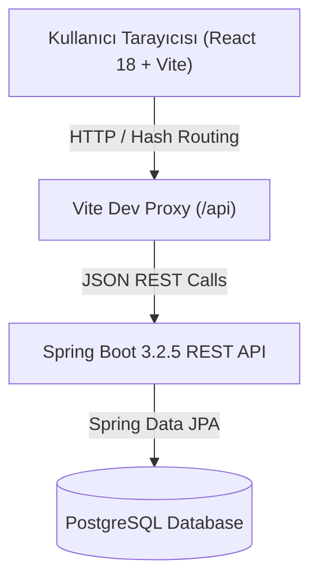

# 10Signal — Kapsamlı Proje ve Mimari Dokümantasyonu

> **Versiyon:** 2.4 (Son Güncelleme: Eylül 2026)  
> **Kapsam:** Uçtan Uca Sistem Mimarisi, Ürün Mantığı, Algoritmalar, Frontend & Backend Kod Haritası, Güvenlik, Psikometri ve Devralma Kılavuzu.

---

## 1. Giriş ve Ürün Vizyonu

**10Signal**, bireylerin kendilerini nasıl algıladıkları (*Self View*) ile çevrelerindeki insanların (arkadaşlar, iş arkadaşları, sosyal çevre) onları nasıl deneyimlediklerini (*Outside View*) karşılaştıran iki katmanlı bir sosyal algı ve kişilik analizi platformudur.

### Temel Değer Önerisi
1. **İkili Algı Karşılaştırması (*The Mirror Effect*):** Kullanıcı önce 10 temel sosyal sinyal üzerinden kendini puanlar (*Self Snapshot*). Ardından ürettiği özel davet bağlantısıyla arkadaşlarından anonim değerlendirmeler toplar (*Outside Snapshot*).
2. **Kör Nokta & İllüzyon Analizi (*Gap Analysis*):** Kullanıcının kendine atfettiği özellikler ile dış algı arasındaki farklar matematiksel olarak hesaplanır (Örn: *Daha Samimi / Warmer Outside*, *Gizli Derinlik / Hidden Depth*, *Sert Algılanma / Misread Edge* vb.).
3. **Okuyucu Oyunu & Gamification (*Reader Game & Accuracy*):** Arkadaşların hedef kişiyi ne kadar doğru tahmin ettiği (*Accuracy %*) ölçülür, okuyucuya bir kişilik tipi (*Reader Style*) ve XP/Seviye atanır.
4. **Nadir Kimlik Kartları (*Dynamic Rarity Engine*):** 45 farklı sosyal kimlik kartı, veritabanındaki gerçek popülasyon dağılımına göre dinamik nadirlik (*Mythic, Legendary, Rare, Uncommon, Common*) yüzdeleri kazanır.
5. **Zero-Leak Gizlilik İlkesi:** Arkadaş yanıtları 3'ün altındayken dış algı ve gap verileri kesinlikle maskelenir; bireysel yanıtların ifşa edilmesi engellenir.

---

## 2. Teknoloji Yığını & Sistem Mimarisi



### 2.1 Backend Yığını
- **Çalışma Zamanı & Çatı:** Java 17, Spring Boot `3.2.5`
- **Modüller:** Spring Web (MVC), Spring Data JPA, Spring Validation (Jakarta), Lombok, Spring Boot Starter Test.
- **Veritabanı:** PostgreSQL (development, test ve production). H2 artık desteklenmez.
- **Güvenlik & Kriptografi:** SHA-256 Token Hashing, Secure Random Token/Slug Generation, IP & Fingerprint bazlı spam koruması.
- **Mimari Desen:** Controller - Service - Repository - Entity - DTO katmanlı mimarisi, Optimistic Locking (`@Version`).

### 2.2 Frontend Yığını
- **Çalışma Zamanı & Paketleyici:** React `18.3.1`, Vite `7.x`
- **Stil & Tasarım Sistemi:** Tailwind CSS v4, Porselen / Kağıt Dokusu (*Paper Wash & Paper Grain*), Fraunces (Serif/Heading), Geist Sans & Mono.
- **Yönlendirme (Routing):** Native Hash-Based Routing (`#/`, `#/dashboard`, `#/settings`, `#/identities`, `#/faq`, `#/plans`, `#/terms`, `#/privacy`, `#/friend/...`).
- **Paylaşım & Grafik:** `html2canvas` dinamik import (1080x1920 Instagram Story & WhatsApp kart render altyapısı).
- **Çoklu Dil (i18n):** `LocaleContext` (Türkçe `tr` ve İngilizce `en` dinamik JSON katalogları).

---

## 3. Dizin ve Dosya Haritası

```text
10Signal/
├── README.md
├── PROJECT_DOCUMENTATION.md
├── .gitignore
├── docker-compose.dev.yml
├── docs/
│   └── email-notifications.md                         # Brevo & Outbox mimari kılavuzu
├── performance/
│   ├── k6-tensignal.js
│   └── node-load.mjs
│
├── backend/
│   ├── pom.xml
│   ├── Dockerfile
│   ├── PRODUCTION_MIGRATION.md
│   ├── PRODUCTION_OBSERVABILITY.md
│   ├── PRODUCTION_PERFORMANCE.md
│   ├── PRODUCTION_RESILIENCE.md
│   └── src/
│       └── main/
│           ├── java/com/tensignal/backend/
│           │   ├── TenSignalApplication.java
│           │   ├── config/                            # Güvenlik, profil, CORS ve ödeme kuralları
│           │   ├── constant/                          # Sabitler, enum'lar (OtpPurpose, vb.)
│           │   ├── controller/
│           │   │   ├── TenSignalController.java       # Ana 10Signal API & Profil & Friend akışları
│           │   │   ├── BillingController.java         # Plus abonelik, kapasite paketi, hesap silme
│           │   │   └── CardRarityController.java      # Dinamik kart nadirlik motoru API'si
│           │   ├── dto/                               # Request ve Response DTO modelleri
│           │   ├── email/                             # Brevo, SMTP, Outbox Worker & Template Engine
│           │   ├── entity/                            # JPA Entity modelleri
│           │   ├── exception/                         # Global Exception Handler ve hata tipleri
│           │   ├── observability/                     # Prometheus metrikleri ve Audit logging
│           │   ├── payment/                           # Lemon Squeezy sağlayıcı ve Webhook doğrulama
│           │   ├── repository/                        # Spring Data JPA Repository arayüzleri
│           │   └── service/                           # İş mantığı servisleri
│           └── resources/
│               ├── application.yml                    # Temel uygulama yapılandırması
│               ├── application-dev.yml                # Geliştirici profili (localhost)
│               ├── application-prod.yml               # Production profili (Docker/güvenli)
│               ├── db/migration/                      # Flyway SQL migration zinciri (V1 - V8)
│               └── i18n/email/                        # Çok dilli e-posta şablonları (TR / EN)
│
└── frontend/
    ├── package.json
    ├── vite.config.js
    ├── index.html
    └── src/
        ├── App.jsx                                    # Ana Router ve Route Dispatcher
        ├── main.jsx
        ├── index.css                                  # Porselen teması, Tailwind tokens, tipografi
        ├── services/
        │   └── api.js                                 # Tüm Backend REST API istemci fonksiyonları
        ├── context/
        │   └── LocaleContext.jsx                      # TR/EN Dil Sağlayıcı (i18n)
        ├── hooks/
        │   └── useTenSignalShare.js                      # WhatsApp & Instagram Story canvas üretici
        ├── utils/
        │   ├── psychometrics.js                       # Kalibre edilmiş trait, alignment ve accuracy
        │   └── rarityEngine.js                        # İstemci tarafı nadirlik hesaplama ve etiketleme
        ├── images/
        │   ├── avatars.js                             # 12 Karakter Avatarı (6 Kadın, 6 Erkek)
        │   ├── cardImages.js                          # 45 Sosyal Kimlik kart görsel haritası
        │   └── readerCardImages.js                    # 5 Okuyucu Stil kart görsel haritası
        ├── pages/
        │   ├── QuizPage.jsx                           # Ana Wizard: Onboarding, Self Quiz, Claim
        │   ├── DashboardPage.jsx                      # 5 Sekmeli Kullanıcı Kontrol Paneli
        │   ├── SettingsPage.jsx                       # Profil, Üyelik/Kapasite ve Bildirim Ayarları
        │   ├── IdentitiesPage.jsx                     # 45 Sosyal Kimlik Keşif Kataloğu
        │   ├── FaqPage.jsx                            # SSS Akordiyonu & İletişim
        │   ├── PlansPage.jsx                          # Fiyatlandırma ve Paket Detayları
        │   ├── TermsOfUsePage.jsx                     # Global Terms & Conditions (İade Şartları dahil)
        │   ├── PrivacyPolicyPage.jsx                  # Global Privacy Policy (GDPR / CCPA)
        │   ├── FriendIntroPage.jsx                    # Arkadaş Karşılama & Uygunluk Kontrolü
        │   ├── FriendQuizPage.jsx                     # 10 Soruluk Arkadaş Değerlendirme & Süre Analitiği
        │   ├── FriendResultPage.jsx                   # Arkadaş Reader Style ve Doğruluk Sonucu
        │   ├── ResultPage.jsx                         # Test Tamamlama Ara Ekranı
        │   ├── dashboard/                             # Dashboard Alt Sekme Bileşenleri
        │   │   ├── SelfPerceptionTab.jsx
        │   │   ├── OutsidePerceptionTab.jsx
        │   │   ├── DashboardGapTab.jsx
        │   │   ├── DecisionTimesTab.jsx
        │   │   ├── DashboardResponsesTab.jsx
        │   │   ├── ResponseDetailDrawer.jsx
        │   │   └── DashboardQrModal.jsx
        │   ├── quiz/                                  # Quiz Alt Bileşenleri
        │   │   ├── QuizOnboardingStep.jsx
        │   │   ├── QuizQuestionsRunner.jsx
        │   │   ├── QuizSelfResultCard.jsx
        │   │   ├── QuizAuthClaimModal.jsx
        │   │   └── QuizLanguageDropdown.jsx
        │   ├── identities/                            # Kimlikler Alt Bileşenleri
        │   │   ├── IdentitiesFilterBar.jsx
        │   │   ├── IdentitiesCardGrid.jsx
        │   │   └── IdentityDetailModal.jsx
        │   └── settings/                              # Ayarlar Alt Bileşenleri
        │       ├── SettingsProfileTab.jsx
        │       ├── SubscriptionTab.jsx
        │       └── NotificationsTab.jsx
        ├── components/
        │   ├── site-header.jsx                        # Porselen Sticky Header & Kullanıcı Menüsü
        │   ├── site-footer.jsx                        # 16Personalities standardı konsolide Footer
        │   ├── AppShell.jsx                           # Tüm sayfalar için birleşik Layout Shell
        │   ├── LandingPage.jsx                        # Ana Karşılama Sayfası
        │   ├── LocaleSwitch.jsx                       # Dil Seçici (TR / EN)
        │   └── marks.jsx                              # Porselen suluboya efektleri & dekoratif elemanlar
        └── content/locales/
            ├── tr/                                    # Türkçe JSON içerik katalogları
            └── en/                                    # İngilizce JSON içerik katalogları
```

---

## 4. Temel Psikometri ve Algoritma Motoru

10Signal'ın arkasındaki matematiksel motor **10 Sosyal Sinyal**, **4 Sosyal Aile**, **45 Sosyal Kimlik**, **8 Gap Modeli** ve **5 Okuyucu Tipi** üzerine kuruludur.

### 4.1 On Sosyal Sinyal (*Core Social Lenses*)

Tüm testler (Self ve Friend) 1-5 arası Likert ölçeğinde cevaplanır. Backend normalizasyon formülü:

$$\text{Normalized Value} = \frac{\text{Answer Value} - 1}{4.0} \quad \in [0.0, 1.0]$$

| Sinyal Adı | Kod | Temsil Ettiği Nitelik |
|---|---|---|
| **Samimiyet** | `samimiyet` | Sıcaklık, ulaşılabilirlik, empati ve içtenlik |
| **Çekicilik** | `cekicilik` | Karizma, manyetizma, estetik duruş ve çekim gücü |
| **Zeka** | `zeka` | Analitik düşünce, mantık, problem çözme ve kıvraklık |
| **Vizyon** | `vizyon` | Gelecek odaklılık, inovasyon, büyük resmi görme |
| **Enerji** | `enerji` | Yaşam coşkusu, ortamın dinamosu olma, hareketlilik |
| **Güvenilirlik** | `guvenilirlik` | Sadakat, sır tutma, sarsılmaz destek ve tutarlılık |
| **Ego** | `ego` | Özgüven, otorite, sınır koyabilme, mağrur duruş |
| **Başarı** | `basari` | Hırs, hedef odaklılık, azim ve sonuç alma becerisi |
| **Cömertlik** | `comertlik` | Paylaşımcılık, vakit ve kaynak ayırma, vericilik |
| **Olgunluk** | `olgunluk` | Duygusal denge, dinginlik, bilgelik ve sakin güç |

### 4.2 Dört Sosyal Aile (*Social Families*)

Sosyal sinyallerin ağırlıklı bileşimiyle kullanıcının genel aurası belirlenir:

1. **Grounded Presence (`grounded_presence`):**  
   $$\text{Skor} = \frac{\text{olgunluk} + \text{guvenilirlik} + \text{samimiyet}}{3}$$
2. **Warm Access (`warm_access`):**  
   $$\text{Skor} = \frac{\text{samimiyet} + \text{comertlik} + \text{enerji}}{3}$$
3. **Hidden Depth (`hidden_depth`):**  
   $$\text{Skor} = \frac{\text{zeka} + \text{vizyon} + \text{olgunluk}}{3}$$
4. **Clear Energy (`clear_energy`):**  
   $$\text{Skor} = \frac{\text{cekicilik} + \text{basari} + \text{ego} + \text{enerji}}{4}$$

### 4.3 Kırk Beş Sosyal Kimlik (*Social Signatures*)

10 sinyalin $\binom{10}{2} = 45$ ikili permütasyonu kullanıcının birincil kimlik kartını oluşturur.  
Kart skoru formülü:

$$\text{Card Score} = \text{Signal}_1 \times \text{Signal}_2$$

En yüksek skoru alan kart belirlenir (Eşitlik durumunda öncelik sırası uygulanır).

*Örnek Eşleşmeler:*
- `the_leader` (Doğal Lider): Başarı + Olgunluk
- `the_visionary` (Fikir Babası): Vizyon + Zeka
- `the_magnet` (Sosyal Mıknatıs): Çekicilik + Enerji
- `the_safe_haven` (Güvenli Liman): Güvenilirlik + Samimiyet
- `the_ice_queen_king` (Buzdan Kale): Çekicilik + Ego
- `the_golden_retriever` (Neşeli Çıpa): Enerji + Güvenilirlik
- `the_stoic_king` (Soğuk Otorite): Ego + Olgunluk

### 4.4 Fark Analizi Modelleri (*Gap Patterns*)

Dış algı ortalaması ile self ortalaması arasındaki fark hesaplanır:

$$\Delta_{\text{signal}} = \text{Outside Average} - \text{Self Average}$$

| Gap Modeli ID | Hesaplama Mantığı | Anlamı |
|---|---|---|
| `warmer_outside` | $\Delta_{\text{samimiyet}}$ | İnsanlar sizi kendinizi gördüğünüzden daha sıcak buluyor |
| `louder_outside` | $\Delta_{\text{cekicilik}} + \Delta_{\text{enerji}}$ | Enerjiniz ve çekiminiz dışarıya daha baskın yansıyor |
| `softer_outside` | $\Delta_{\text{samimiyet}} - \Delta_{\text{ego}}$ | Sert durduğunuzu sansanız da yumuşak algılanıyorsunuz |
| `more_reserved_outside` | $\Delta_{\text{ego}} + \Delta_{\text{olgunluk}}$ | Dışarıdan daha mesafeli ve ağırbaşlı görünüyorsunuz |
| `clearer_outside` | $\Delta_{\text{guvenilirlik}}$ | İnsanlar size sandığınızdan çok daha fazla güveniyor |
| `hidden_depth` | $\Delta_{\text{zeka}} + \Delta_{\text{vizyon}}$ | Derinliğiniz ve vizyonunuz zamanla daha çok parlıyor |
| `slow_reveal_gap` | $\Delta_{\text{olgunluk}} - \Delta_{\text{enerji}}$ | İlk bakışta enerjik, tanıdıkça bilge bir duruş |
| `misread_edge` | $\Delta_{\text{ego}} - \Delta_{\text{samimiyet}}$ | Özgüveniniz bazen mesafe/soğukluk olarak algılanabiliyor |

**Fark Şiddeti (*Gap Strength*):**
- $\max(|\Delta|) > 0.25 \implies \textbf{Strong}$
- $\max(|\Delta|) > 0.15 \implies \textbf{Clear}$
- Diğer durumlar $\implies \textbf{Subtle}$

### 4.5 Okuyucu Oyunu & Doğruluk Skoru (*Reader Accuracy & Styles*)

Her arkadaş değerlendirmesinde, arkadaşın puanları ile kullanıcının kendi verdiği puanlar karşılaştırılır:

$$\text{Total Diff} = \sum_{i=1}^{10} |\text{Friend}_i - \text{Self}_i|$$

$$\text{Accuracy \%} = 100 \times \left(1 - \frac{\text{Total Diff}}{10 \times 4}\right)$$

| Doğruluk Aralığı | Reader Style ID | Tanım |
|---|---|---|
| **%90 - %100** | `telepathic_reader` | Telepatik Okuyucu (Hedef kişiyi neredeyse kusursuz tanıyor) |
| **%75 - %89** | `clear_reader` | Net Okuyucu (Güçlü sezgiler ve yüksek uyum) |
| **%55 - %74** | `balanced_reader` | Dengeli Gözlemci (Genel hatlarıyla doğru, detaylarda serbest) |
| **%35 - %54** | `casual_explorer` | Yüzeysel Kâşif (Henüz derin bağ kurulmamış) |
| **%0 - %34** | `social_stranger` | Sosyal Yabancı (Algılar tamamen zıt noktalarda) |

---

## 5. REST API Referansı

Tüm API uçları standart JSON yanıtları üretir.

### 5.1 Profil ve Quiz API'leri (`/api/v1/tensignal`)

#### 1. Profil Oluşturma
- **Endpoint:** `POST /api/v1/tensignal/create`
- **Request Body:**
  ```json
  {
    "displayName": "Emre",
    "email": "emre@example.com",
    "selfAnswers": [
      { "questionId": "classic_self_samimiyet_01", "answerValue": 5 },
      { "questionId": "classic_self_cekicilik_01", "answerValue": 4 }
    ]
  }
  ```
- **Response (200 OK):**
  ```json
  {
    "ownerToken": "raw_private_token_xyz...",
    "publicSlug": "vX8kL2m9",
    "resultSnapshot": { ... }
  }
  ```

#### 2. E-posta Doğrulama Kodu Gönderme
- **Endpoint:** `POST /api/v1/tensignal/auth/send-code?isLogin=false`
- **Body:** `{ "email": "emre@example.com" }`
- **Response:** `{ "status": "code_sent", "email": "emre@example.com" }`

#### 3. E-posta Girişi (Hızlı Giriş)
- **Endpoint:** `POST /api/v1/tensignal/auth/login-email`
- **Body:** `{ "email": "emre@example.com", "code": "1234" }`
- **Response:** `{ "ownerToken": "new_raw_token", "publicSlug": "vX8kL2m9" }`

#### 4. Sahip Paneli Verisi Çekme
- **Endpoint:** `GET /api/v1/tensignal/owner/{ownerToken}`
- **Response:** `ResultSnapshotDto` (Tüm yanıtlar, süre analitikleri ve gap detayları açık).

#### 5. Public Profil Verisi Çekme (Arkadaş Görünümü)
- **Endpoint:** `GET /api/v1/tensignal/public/{publicSlug}`
- **Response:** `ResultSnapshotDto` (Yanıt sayısı < 3 ise dış algı alanları `null` maskelenir).

#### 6. Arkadaş Değerlendirme Uygunluk Kontrolü
- **Endpoint:** `POST /api/v1/tensignal/friend/{publicSlug}/check-eligibility`
- **Headers:** `X-Owner-Token: optional`
- **Body:** `{ "fingerprintHash": "fp_hash_123" }`
- **Response:** `{ "eligible": true }` (Owner ise veya daha önce çözüldüyse 403/409 döner).

#### 7. Arkadaş Yanıtlarını Kaydetme
- **Endpoint:** `POST /api/v1/tensignal/friend/{publicSlug}/respond`
- **Headers:** `X-Owner-Token: optional`
- **Body:**
  ```json
  {
    "nickname": "Ahmet",
    "fingerprintHash": "fp_hash_123",
    "friendResponses": [
      { "questionId": "classic_friend_samimiyet_01", "answerValue": 4 }
    ],
    "friendTimeAnalytics": {
      "samimiyet": 2340,
      "cekicilik": 1890
    }
  }
  ```
- **Response:**
  ```json
  {
    "readerStyleId": "clear_reader",
    "xpGained": 15,
    "level": 1,
    "accuracy": 87.5,
    "resultSnapshot": { ... }
  }
  ```

#### 8. Profil Ayarları Güncelleme
- `PUT /api/v1/tensignal/owner/display-name` (Body: `{ "displayName": "YeniAd" }` — 14 gün cooldown kuralı içerir).
- `PUT /api/v1/tensignal/owner/email` (Body: `{ "email": "yeni@example.com" }`).
- `PUT /api/v1/tensignal/owner/avatar` (Body: `{ "avatar": "erkek3" }`).

---

### 5.2 Dinamik Nadirlik API'leri (`/api/v1/rarity`)

- `GET /api/v1/rarity/all?lang=tr` $\implies$ 45 kartın canlı popülasyon dağılım yüzdeleri ve nadirlik rozetleri (`legendary`, `rare`, vb.).
- `GET /api/v1/rarity/card/{cardId}?lang=tr` $\implies$ Tek bir kartın canlı nadirlik bilgisi.
- `POST /api/v1/rarity/event/generated` $\implies$ Yeni kart üretildiğinde sayaç artırma olayı.

---

### 5.3 Faturalandırma & Üyelik API'leri (`/api/billing`)

- `POST /api/billing/subscribe-plus` (Header: `X-Owner-Token` $\implies$ Sınırsız yanıt kapasitesi ve Plus rozeti).
- `POST /api/billing/buy-pack?amount=100` (Header: `X-Owner-Token` $\implies$ 100, 250 veya 500 ek yanıt kapasitesi).
- `DELETE /api/billing/delete-account` (Header: `X-Owner-Token` $\implies$ Kullanıcıya ve profile ait tüm verileri kalıcı silme - GDPR Right to Erasure).

---

## 6. Frontend Mimarisi & Sayfa Rotaları

Frontend, Vite ile derlenen SPA yapısındadır. Sayfalar hash bazlı yönlendirilir:

```text
#/                       -> QuizPage (Landing / Wizard / Auth / Claim)
#/dashboard              -> DashboardPage (5 Sekmeli Analiz Paneli)
#/settings               -> SettingsPage (?tab=profile | plans | notifications)
#/identities             -> IdentitiesPage (45 Kimlik Kartı Kataloğu & Modal)
#/faq                    -> FaqPage (SSS ve İletişim)
#/plans                  -> PlansPage (Üyelik & Kapasite Paketleri)
#/terms                  -> TermsOfUsePage (Terms & Conditions - Tek Dil EN)
#/privacy                -> PrivacyPolicyPage (Privacy Policy - Tek Dil EN)
#/friend/{slug}          -> FriendIntroPage (Arkadaş Karşılama)
#/friend/{slug}/quiz     -> FriendQuizPage (Arkadaş Değerlendirme Testi)
#/friend/{slug}/result   -> FriendResultPage (Arkadaş Reader Sonucu)
```

### 6.1 Unified Sticky Header (`SiteHeader`)
- Porselen renk paleti, `position: sticky; top: 0; z-index: 100`.
- Sayfa aşağı kaydırıldığında `scrolled` tetiklenir: `backdrop-blur-md`, `paper-grain` dokusu ve porselen sınır çizgisi aktifleşir.
- Giriş yapılmışsa profil avatarı ve kullanıcı menüsü (Profil, Üyelik, Bildirimler, Dashboard, Çıkış Yap) gösterilir.
- Giriş yapılmamışsa şık "Giriş Yap" butonu ve dil seçici yer alır.

### 6.2 Konsolide Footer (`SiteFooter`)
- 16Personalities standardında iki ana yasal bağlantı barındırır:
  1. `Privacy Policy` $\implies$ `#/privacy`
  2. `Terms & Conditions` $\implies$ `#/terms` (İade şartları Madde 5'te entegre).
- SSS (`#/faq`), Sosyal Kimlikler (`#/identities`) ve İletişim bağlantıları mevcuttur.

---

## 7. Güvenlik, Gizlilik & Anti-Abuse Standartları

1. **Kriptografik Token Ayrımı:**
   - Kullanıcıya yalnızca raw token teslim edilir.
   - Veritabanında asla açık token saklanmaz; yalnızca `SHA-256 + Base64URL` hash saklanır (`ownerTokenHash`).
2. **Zero-Leakage Koruması:**
   - 3 yanıttan az veriye sahip profillerde `outsideSignatureId`, `outsideFamilyId`, `gapPatternId` ve `gapStrength` alanları API seviyesinde `null` döndürülür.
3. **Self-Evaluation Önleme:**
   - Bir profil sahibi kendi arkadaş bağlantısını çözmeye çalıştığında `X-Owner-Token` kontrolüyle istek anında reddedilir.
4. **Duplicate & Spam Filtresi:**
   - `IP Address + Browser Fingerprint` kombinasyonu her 10Signal profili için tekil olarak kaydedilir; mükerrer yanıtlar engellenir.
5. **Eşzamanlı Kota Yarışı Önleme (Concurrency Safe):**
   - `TenSignal` entity'sinde JPA `@Version` ile Optimistic Locking uygulanmıştır. Aynı anda gelen onlarca yanıtta kota aşımı engellenir.

---

## 8. Kurulum, Çalıştırma ve Test

### 8.1 Ön Gereksinimler
- Java 17+ (JDK)
- Apache Maven 3.8+
- Node.js 18+ & npm
- PostgreSQL 16+ (local development ve integration test için)

### 8.2 Backend Başlatma
```bash
docker compose -f docker-compose.dev.yml up -d
cd backend
mvn spring-boot:run -Dspring-boot.run.profiles=dev
```
*Backend varsayılan olarak `http://localhost:8080` portunda ayağa kalkar. Dev profili `seenly_dev` PostgreSQL veritabanını kullanır; yerel varsayılan kullanıcı/parola yalnızca geliştirme içindir. Alternatif olarak `DEV_DB_URL`, `DEV_DB_USERNAME` ve `DEV_DB_PASSWORD` ortam değişkenleri verilebilir. Flyway dev/test/prod ortamlarında şemayı yönetir ve Hibernate `ddl-auto=validate` ile yalnızca doğrulama yapar.*

### 8.2.1 Test Veritabanı
Integration test profili PostgreSQL semantiğiyle çalışır ve varsayılan olarak `seenly_test` veritabanını bekler. Yerel PostgreSQL kullanılıyorsa `TEST_DB_URL`, `TEST_DB_USERNAME` ve `TEST_DB_PASSWORD` ile izole test veritabanı açıkça gösterilmelidir. Testler development veya production veritabanını hedeflememelidir.

### 8.3 Frontend Başlatma
```bash
cd frontend
npm install
npm run dev
```
*Frontend varsayılan olarak `http://localhost:3000` portunda Vite dev server ile başlar ve `/api` isteklerini backend'e proxy eder.*

### 8.4 Production Derlemesi
```bash
# Frontend Build
cd frontend
npm run build

# Backend Test & Package
cd backend
mvn clean package -DskipTests
```

---

## 9. Gelecek Geliştirme Notları & Yol Haritası

- **Gerçek Ödeme Sağlayıcı Entegrasyonu:** `BillingController` mock servislerinin Stripe / Iyzico webhook altyapısına bağlanması.
- **E-posta Servis Sağlayıcısı:** Brevo Transactional Email REST API ile canlı e-posta gönderimi entegre edilmiştir (10Signal <mail@10signal.me>).
- **Veritabanı Migration:** Flyway kalıcı tüm ortamlarda tek şema yönetim yoludur; yeni şema değişiklikleri `backend/src/main/resources/db/migration` altında migration olarak eklenmelidir.
- **Push Bildirimleri:** Arkadaş testi tamamlandığında sahibe web-push veya e-posta anlık bildirimi gönderilmesi.

---
*10Signal mimari ve kodlama dokümantasyonu projenin en güncel durumunu yansıtmaktadır.*
