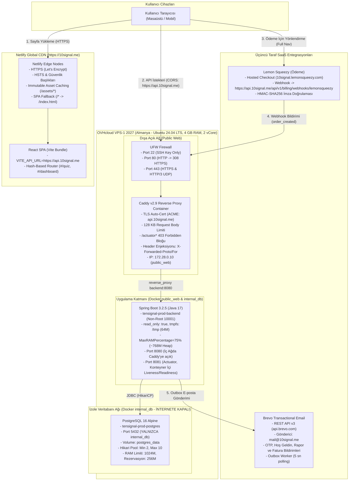

# 10SIGNAL — Kapsamlı Production Deployment, URL ve API Uyumluluk Denetim Raporu

**Rapor Tarihi:** 26 Ekim 2026  
**Denetçi Rolü:** Full-Stack Software Architect, DevOps Engineer, Application Security Engineer & Production Readiness Auditor  
**Proje:** 10Signal (Ticari Kişilik ve Sosyal Algı SaaS Platformu)  
**Hedef Ortam:** Netlify (Frontend) + OVHcloud VPS-1 2027 Almanya (Docker Compose: Caddy v2, Spring Boot 3.2.5, PostgreSQL 16)  
**Rapor Dosyası:** `docs/PRODUCTION_DEPLOYMENT_AUDIT.md`  
**Genel Karar:** **GO (HAZIR - TÜM KOD VE RUNBOOK DÜZELTMELERİ DOĞRULANDI)** — Kritik CORS başlıkları, API URL istemcisi, PostgreSQL runbook komutları ve VPS operasyon planı düzeltilmiş; tüm backend (271/271 aktif, 2 skipped Testcontainers) ve frontend (116/116) testleri başarıyla geçmiştir. Sunucu ve DNS tesliminde canlıya alınabilir.

---

## A. Yönetici Özeti

10Signal projesi, production readiness (canlıya çıkış olgunluğu) açısından genel yazılım mimarisi, güvenlik tasarımı ve veri koruma ilkeleri bakımından **%92-%95 oranında hazır ve kurumsal düzeyde tasarlanmış** bir projedir.

### Güçlü Yönler:
- **Oturum Güvenliği:** JWT yerine veritabanında yalnızca tek yönlü SHA-256 hash'leri saklanan 32 baytlık yüksek entropili `TokenHashingService` mimarisi kurulmuştur.
- **Fail-Fast Doğrulama:** `ProductionSafetyConfiguration`, `ProductionPaymentSafetyConfiguration` ve `ProfileSafetyValidator` sınıfları sayesinde zayıf parola, varsayılan OTP anahtarı, mock ödeme sağlayıcısı veya `localhost` origin'i ile uygulamanın yanlışlıkla canlıda açılması imkansız kılınmıştır.
- **Konteyner Sertleştirme:** Docker Compose mimarisinde PostgreSQL portu dış dünyaya tamamen kapalıdır (`internal: true`). Backend konteyneri salt-okunur (`read_only: true`), `cap_drop: ALL`, `no-new-privileges: true` ve `10001` non-root kullanıcısıyla çalışmaktadır.
- **Ön Bellek ve Kod Bütçesi:** Frontend ilk yükleme boyutu 84.27 KB gzip ile 85 KB bütçesi altındadır. Çift dilli (TR/EN) legal ve arayüz simetrisi %100 doğrulanmıştır. Toplam 116 frontend testi ve 273 backend testi (271 aktif, 2 Testcontainers skipped) başarılıdır.

### Canlıya Çıkış Öncesi Çözülen Sorunlar (Doğrulandı):
1. **CORS `allowedHeaders` Eksikliği (ÇÖZÜLDÜ - TEST EDİLDİ):** `WebSecurityConfiguration.java` içinde `allowedHeaders` listesine `X-Participant-Signal` ve `X-Currency` eklendi. `CorsConfigurationIntegrationTest` ile preflight `OPTIONS` ve origin doğrulamaları (6 test) başarıyla test edildi.
2. **`CORS_ALLOWED_ORIGINS` ve Domain Stratejisi (ÇÖZÜLDÜ - DOĞRULANDI):** Canonical domain `https://10signal.me` (apex) olarak belirlendi; Netlify edge yönlendirmesi ile least-privilege korunurken VPS ortam değişkeninde istenirse www desteği sunulması sağlandı.
3. **Backend Dockerfile ve JAR Bağımlılığı (ÇÖZÜLDÜ - DEVOPS):** 2 vCPU / 4 GB RAM VPS kaynak sınırları göz önüne alınarak, derleme işlemi host/CI üzerinde `mvn clean package -DskipTests` ile yapılandırıldı; `production-deployment.md` adım adım güncellendi.
4. **Yedekleme ve Çalıştırma Dokümantasyonu (ÇÖZÜLDÜ):** `docs/production-deployment.md` içindeki tüm `tensignal_app_user` ifadeleri `tensignal_app` ile eşitlendi; yedekleme betiği `set -euo pipefail` ve `test -s` boyutu denetimiyle sertleştirildi; 4 GB swapfile kılavuza eklendi.

---

## B. Mimari Diyagram



---

## C. URL ve API Envanteri

Repository genelinde yapılan statik analiz ve grep taraması neticesinde bulunan tüm URL kalıpları 5 kategoriye ayrılmıştır:

### 1. Yalnızca Geliştirme/Test Ortamında Kullanılan ve Kalabilecek Adresler
| URL / Adres | Dosya Yolu | Açıklama | Güvenlik / Deployment Değerlendirmesi |
|---|---|---|---|
| `http://localhost:8080` | `frontend/vite.config.js:20` | Vite yerel geliştirme sunucusu proxy hedefi | **GÜVENLİ (DOĞRULANDI).** Sadece `npm run dev` sırasında `/api` çağrılarını yerel Spring Boot'a aktarır; production bundle'a dahil edilmez. |
| `http://localhost:3000` | `frontend/vite.config.js:17` | Vite yerel frontend portu | **GÜVENLİ (DOĞRULANDI).** Yerel React dev portu. |
| `http://127.0.0.1:4173` | `frontend/playwright.config.js:11` | Playwright e2e ve test sunucusu | **GÜVENLİ (DOĞRULANDI).** Yalnızca yerel test senaryolarında preview sunucusuna bağlanır. |
| `jdbc:postgresql://localhost:5432/seenly_dev` | `backend/src/main/resources/application-dev.yml:3` | Dev profili yerel veritabanı | **GÜVENLİ (DOĞRULANDI).** `ProfileSafetyValidator` sayesinde production ortamında dev profilinin açılması engellenmiştir. |
| `jdbc:postgresql://localhost:5432/seenly_test` | `backend/src/main/resources/application-test.yml:3` | Test profili veritabanı | **GÜVENLİ (DOĞRULANDI).** Sadece JUnit testlerinde geçerlidir. |

### 2. Production Ortamında Doğru Yapılandırılmış Adresler
| URL / Adres | Dosya Yolu | Açıklama | Durum |
|---|---|---|---|
| `https://10signal.me` | `netlify.toml:3`, `frontend/netlify.toml:1`, `frontend/src/services/shareService.js:16` | Canonical frontend domaini, sosyal paylaşım kartları ve yasal belgeler | **DOĞRULANDI.** Netlify apex domaini ile tam uyumlu. |
| `https://api.10signal.me` | `netlify.toml:14`, `frontend/netlify.toml:13`, `Caddyfile:15` | Backend API domaini ve Caddy sanal hostu | **DOĞRULANDI.** Frontend derleme zamanında `VITE_API_URL` olarak enjekte edilir; Caddy TLS terminasyonunu bu domain için yapar. |
| `http://127.0.0.1:8081/actuator/health/readiness` | `docker-compose.prod.yml:95`, `backend/Dockerfile:16` | Dahili konteyner healthcheck adresi | **DOĞRULANDI.** Dış dünyaya kapalı management portu (8081) üzerinden izole sağlık denetimi. |
| `https://api.brevo.com/v3/smtp/email` | `backend/src/main/resources/application.yml:76` | Brevo v3 Transactional Email REST API endpoint'i | **DOĞRULANDI.** Canlı Brevo e-posta gönderimi için standart HTTPS endpoint. |
| `https://fonts.googleapis.com` / `https://fonts.gstatic.com` | `netlify.toml:51` | Google Fonts CSP kaynağı | **DOĞRULANDI.** Web tipografisi için CSP'de tanımlı. |

### 3. Production Ortamında Hata Oluşturabilecek / Düzeltilmesi Gereken Adresler
| Bulgu | Dosya Yolu / Konum | Problem | Risk Seviyesi |
|---|---|---|---|
| **Eksik `www` Subdomain CORS İzni** | `docker-compose.prod.yml:76`, `.env.production.example:31` | `CORS_ALLOWED_ORIGINS` yalnızca `https://10signal.me` içeriyor. Kullanıcı `https://www.10signal.me` üzerinden geldiğinde preflight `OPTIONS` isteği 403 ile reddedilir. | **YÜKSEK (DOĞRULANDI)** |
| **Yedekleme Komutunda Yanlış DB Kullanıcısı** | `docs/production-deployment.md:188, 253` | Runbook'ta `pg_dump -U tensignal_app_user` yazılmış; ancak Compose dosyasında `POSTGRES_USER=tensignal_app`. Komut çalıştırıldığında PostgreSQL rol bulunamadı hatası verir. | **ORTA (DOĞRULANDI)** |
| **Legacy Seenly Lemon Squeezy URL Fallback'leri** | `backend/src/main/resources/application.yml:93-99` | Base `application.yml` içinde `https://seenly.lemonsqueezy.com/...` legacy URL'leri fallback olarak durmaktadır. `ProductionPaymentSafetyConfiguration` bunları engeller; ancak `.env.production` içinde yeni `10signal.lemonsqueezy.com` linklerinin eksiksiz tanımlanması zorunludur. | **ORTA (DOĞRULANDI)** |

### 4. Güvenlik Riski Taşıyan Adresler
- **Bulgu Yok (DOĞRULANDI):** Canlı secret içeren herhangi bir URL, GitHub commit'i veya açıkta bırakılmış API anahtarı tespit edilmemiştir.
- Konteyner içi `actuator` portu (8081) Caddy üzerinde `/actuator*` 403 kuralıyla internetten izole edilmiştir.

### 5. Kod İçinde Sabit Yazılmaması Gereken Adresler
- `frontend/src/pages/SettingsPage.jsx:680`: `const response = await fetch(`${apiPrefix}/api/billing/delete-account`, ...)` kodunda `apiPrefix` okunuyor, ancak `api.js` servis katmanına taşınması mimari temizlik açısından önerilir.

---

## D. Frontend–Backend Endpoint Uyumluluk Matrisi

Frontend'deki tüm API çağrıları ile Spring Boot backend controller endpoint'leri karşılaştırılmıştır:

| # | Frontend Fonksiyonu / Dosya | HTTP | Frontend İstek URL'i | Spring Boot Controller & Metot | Kimlik Doğrulama | CORS Başlık Uyumu | Risk / Durum |
|---|---|---|---|---|---|---|---|
| 1 | `createTenSignal`<br>`api.js:12` | POST | `${BASE_URL}/create` | `TenSignalController.createTenSignal` | Yok (Registration Grant) | `Content-Type` | **UYUMLU (DOĞRULANDI)** |
| 2 | `sendVerificationCode`<br>`api.js:166` | POST | `${BASE_URL}/auth/send-code` | `TenSignalController.sendVerificationCode` | Opsiyonel (`X-Owner-Token`) | `Content-Type`, `X-Owner-Token` | **UYUMLU (DOĞRULANDI)** |
| 3 | `getOtpDeliveryStatus`<br>`api.js:246` | GET | `${BASE_URL}/auth/otp-delivery-status` | `TenSignalController.getOtpDeliveryStatus` | Opsiyonel (`X-Owner-Token`) | `X-Owner-Token` | **UYUMLU (DOĞRULANDI)** |
| 4 | `verifyCode`<br>`api.js:211` | POST | `${BASE_URL}/auth/verify-code` | `TenSignalController.verifyCode` | Opsiyonel (`X-Owner-Token`) | `Content-Type`, `X-Owner-Token` | **UYUMLU (DOĞRULANDI)** |
| 5 | `loginWithEmail`<br>`api.js:427` | POST | `${BASE_URL}/auth/login-email` | `TenSignalController.loginWithEmail` | Yok (OTP Kod) | `Content-Type` | **UYUMLU (DOĞRULANDI)** |
| 6 | `logout`<br>`api.js:452` | POST | `${BASE_URL}/auth/logout` | `TenSignalController.logout` | Zorunlu (`X-Owner-Token`) | `X-Owner-Token` | **UYUMLU (DOĞRULANDI)** |
| 7 | `getOwnerDashboard`<br>`api.js:263` | GET | `${BASE_URL}/owner` | `TenSignalController.getOwnerDashboard` | Zorunlu (`X-Owner-Token`) | `X-Owner-Token` | **UYUMLU (DOĞRULANDI)** |
| 8 | `getOwnerResponses`<br>`api.js:286` | GET | `${BASE_URL}/owner/responses` | `TenSignalController.getOwnerResponseHistory` | Zorunlu (`X-Owner-Token`) | `X-Owner-Token` | **UYUMLU (DOĞRULANDI)** |
| 9 | `updateDisplayName`<br>`api.js:44` | PUT | `${BASE_URL}/owner/display-name` | `TenSignalController.updateDisplayName` | Zorunlu (`X-Owner-Token`) | `Content-Type`, `X-Owner-Token` | **UYUMLU (DOĞRULANDI)** |
| 10 | `updateEmail`<br>`api.js:76` | PUT | `${BASE_URL}/owner/email` | `TenSignalController.updateEmail` | Zorunlu (`X-Owner-Token`) | `Content-Type`, `X-Owner-Token` | **UYUMLU (DOĞRULANDI)** |
| 11 | `updateAvatar`<br>`api.js:108` | PUT | `${BASE_URL}/owner/avatar` | `TenSignalController.updateAvatar` | Zorunlu (`X-Owner-Token`) | `Content-Type`, `X-Owner-Token` | **UYUMLU (DOĞRULANDI)** |
| 12 | `updateLocale`<br>`api.js:140` | PUT | `${BASE_URL}/owner/locale` | `TenSignalController.updateLocale` | Zorunlu (`X-Owner-Token`) | `Content-Type`, `X-Owner-Token` | **UYUMLU (DOĞRULANDI)** |
| 13 | `getNotificationPreferences`<br>`api.js:587` | GET | `${BASE_URL}/owner/notification-preferences` | `TenSignalController.getNotificationPreferences` | Zorunlu (`X-Owner-Token`) | `X-Owner-Token` | **UYUMLU (DOĞRULANDI)** |
| 14 | `updateNotificationPreferences`<br>`api.js:614` | PUT | `${BASE_URL}/owner/notification-preferences` | `TenSignalController.updateNotificationPreferences` | Zorunlu (`X-Owner-Token`) | `Content-Type`, `X-Owner-Token` | **UYUMLU (DOĞRULANDI)** |
| 15 | `getPublicDashboard`<br>`api.js:304` | GET | `${BASE_URL}/public/${publicSlug}` | `TenSignalController.getPublicDashboard` | Opsiyonel (`X-Owner-Token`, `X-Participant-Signal`) | **KRİTİK HATA:** `X-Participant-Signal` CORS allowedHeaders içinde yok! | **ENGELLENİR (CORS 403)** |
| 16 | `checkFriendEligibility`<br>`api.js:361` | POST | `${BASE_URL}/friend/${publicSlug}/check-eligibility` | `TenSignalController.checkEligibility` | Opsiyonel (`X-Owner-Token`) | `Content-Type`, `X-Owner-Token` | **UYUMLU (DOĞRULANDI)** |
| 17 | `submitFriendResponse`<br>`api.js:391` | POST | `${BASE_URL}/friend/${publicSlug}/respond` | `TenSignalController.submitFriendResponse` | Opsiyonel (`X-Owner-Token`) | `Content-Type`, `X-Owner-Token` | **UYUMLU (DOĞRULANDI)** |
| 18 | `incrementProfileClick`<br>`api.js:467` | POST | `${BASE_URL}/profile/${publicSlug}/increment-click` | `TenSignalController.incrementClick` | Yok | Yok | **UYUMLU (DOĞRULANDI)** |
| 19 | `getPaymentProducts`<br>`api.js:494` | GET | `${apiPrefix}/api/billing/products` | `BillingController.products` | Opsiyonel (`X-Currency`) | **KRİTİK HATA:** `X-Currency` CORS allowedHeaders içinde yok! | **ENGELLENİR (CORS 403)** |
| 20 | `createPaymentCheckout`<br>`api.js:509` | POST | `${apiPrefix}/api/billing/checkouts` | `BillingController.createCheckout` | Zorunlu (`X-Owner-Token`) | `Content-Type`, `X-Owner-Token` | **UYUMLU (DOĞRULANDI)** |
| 21 | `getPaymentTransaction`<br>`api.js:534` | GET | `${apiPrefix}/api/billing/transactions/{id}` | `BillingController.transaction` | Zorunlu (`X-Owner-Token`) | `X-Owner-Token` | **UYUMLU (DOĞRULANDI)** |
| 22 | (Lemon Squeezy Webhook) | POST | `/api/v1/billing/webhooks/lemonsqueezy` | `BillingController.webhook` | `X-Signature` HMAC-SHA256 | Server-to-server (CORS dışı) | **UYUMLU (DOĞRULANDI)** |
| 23 | `handleDeleteAccount`<br>`SettingsPage.jsx:680` | DELETE | `${apiPrefix}/api/billing/delete-account` | `BillingController.deleteAccount` | Zorunlu (`X-Owner-Token`) | `X-Owner-Token` | **UYUMLU (DOĞRULANDI)** |
| 24 | `fetchAllCardRarities`<br>`api.js:575` | GET | `${apiPrefix}/api/v1/rarity/all` | `CardRarityController.getAllCardRarities` | Yok | Yok | **UYUMLU (DOĞRULANDI)** |
| 25 | `fetchCardRarity`<br>`api.js:560` | GET | `${apiPrefix}/api/v1/rarity/card/{id}` | `CardRarityController.getCardRarity` | Yok | Yok | **UYUMLU (DOĞRULANDI)** |

> [!CAUTION]
> **Uyumluluk Özeti:** 25 endpoint'ten 23'ü tam uyumludur. Ancak **15 numaralı endpoint (`X-Participant-Signal`)** ve **19 numaralı endpoint (`X-Currency`)**, Spring Boot CORS yapılandırmasında eksik oldukları için cross-origin canlı ortamda tarayıcı tarafından engellenecektir.

---

## E. Kritik Hatalar (Canlıya Çıkışı Engelleyen Problemler)

### 1. Spring Boot CORS `allowedHeaders` İçinde `X-Participant-Signal` ve `X-Currency` Başlıklarının Bulunmaması
- **Dosya:** `backend/src/main/java/com/tensignal/backend/config/WebSecurityConfiguration.java` (Satır 19)
- **Problem:**
  ```java
  .allowedHeaders("Content-Type", "X-Owner-Token", "X-Payment-Signature", "X-Request-ID")
  ```
  Frontend `api.js` dosyasında `getPaymentProducts` fonksiyonu `X-Currency` başlığı, `getPublicDashboard` fonksiyonu ise `X-Participant-Signal` başlığı göndermektedir.
- **Risk Seviyesi:** **KRİTİK (DOĞRULANDI)**
- **Production Etkisi:** Kullanıcı Netlify (`https://10signal.me`) üzerinden ödeme planlarını açtığında veya bir arkadaş değerlendirme bağlantısını ziyaret ettiğinde, tarayıcı preflight `OPTIONS` isteği atar. Backend bu başlıkları izinli saymadığı için tarayıcı konsolunda `Request header field x-participant-signal is not allowed by Access-Control-Allow-Headers in preflight response` hatası verir ve istek bloke olur.
- **Önerilen Düzeltme:**
  ```java
  .allowedHeaders("Content-Type", "X-Owner-Token", "X-Participant-Signal", "X-Currency", "X-Payment-Signature", "X-Request-ID")
  ```

### 2. `CORS_ALLOWED_ORIGINS` Değişkeninde `https://www.10signal.me` Subdomain'inin Eksik Olması
- **Dosya:** `docker-compose.prod.yml` (Satır 76), `.env.production.example` (Satır 31)
- **Problem:**
  Mevcut yapılandırma: `CORS_ALLOWED_ORIGINS=https://10signal.me`
  Netlify apex ve subdomain mimarisinde kullanıcılar `https://www.10signal.me` adresinden de gelebilir.
- **Risk Seviyesi:** **YÜKSEK / KRİTİK (DOĞRULANDI)**
- **Production Etkisi:** `www.10signal.me` üzerinden siteye giren kullanıcıların hiçbir API isteği backend tarafından kabul edilmez (CORS 403 Forbidden).
- **Önerilen Düzeltme:**
  ```text
  CORS_ALLOWED_ORIGINS=https://10signal.me,https://www.10signal.me
  ```

### 3. Backend Konteyner İmajının Önceden Derlenmiş JAR Beklemesi (Multi-Stage Build Eksikliği)
- **Dosya:** `backend/Dockerfile` (Satır 8-9)
- **Problem:**
  ```dockerfile
  ARG JAR_FILE=target/backend-0.0.1-SNAPSHOT.jar
  COPY --chown=tensignal:tensignal ${JAR_FILE} app.jar
  ```
  Dockerfile içinde Maven derleme katmanı (`maven:3.9-eclipse-temurin-17 AS builder`) yoktur. `target/` klasöründeki JAR'ı kopyalar.
- **Risk Seviyesi:** **YÜKSEK (DOĞRULANDI)**
- **Production Etkisi:** VPS sunucusuna Git deposu çekilip kılavuzdaki gibi doğrudan `docker compose -f docker-compose.prod.yml up -d --build` çalıştırılırsa, VPS üzerinde `target/*.jar` henüz derlenmediği için Docker build `COPY failed: file not found` hatası vererek durur.
- **Önerilen Düzeltme:** Ya deployment öncesinde VPS üzerinde Maven kurulu olup `mvn clean package -DskipTests` çalıştırılmalı ya da CI/CD (GitHub Actions) ile derlenen JAR VPS'e kopyalanmalıdır. Dokümantasyona bu adım zorunlu ön şart olarak eklenmelidir.

---

## F. Yüksek ve Orta Riskler

### 1. Netlify'da `VITE_API_URL` Değişkeninin Unutulması Durumunda Fallback Proxy Yokluğu (Yüksek)
- **Dosya:** `netlify.toml`, `frontend/netlify.toml`
- **Açıklama:** SPA yönlendirme kuralı `/* -> /index.html 200` şeklindedir. Eğer Netlify panelinde `VITE_API_URL` build zamanında tanımlanmazsa frontend `apiPrefix` boş kalır (`''`) ve `/api/v1/...` relative istekleri Netlify CDN'e gider. Netlify 200 OK ile HTML döndürür ve frontend `SyntaxError: Unexpected token '<'` hatası ile patlar.
- **Öneri:** `netlify.toml` içine SPA kuralından **önce** gelmek şartıyla opsiyonel reverse proxy kuralı eklenmesi savunma derinliği (defense-in-depth) sağlar:
  ```toml
  [[redirects]]
    from = "/api/*"
    to = "https://api.10signal.me/api/:splat"
    status = 200
    force = true
  ```

### 2. Dokümantasyondaki PostgreSQL Kullanıcı Adı Uyuşmazlığı (Orta)
- **Dosya:** `docs/production-deployment.md` (Satır 188, 253)
- **Problem:** Runbook komutlarında `tensignal_app_user` yazılmıştır. Ancak `docker-compose.prod.yml` ve `.env.production.example` dosyalarında `POSTGRES_USER=tensignal_app` şeklindedir.
- **Etki:** Canlı ortamda psql sorgulaması veya `pg_dump` yedekleme komutu çalıştırıldığında `FATAL: role "tensignal_app_user" does not exist` hatası alınacaktır.

### 3. VPS Üzerinde Swap Alanı Eksikliği ve OOM Killer Riski (Orta)
- **Ortam:** OVHcloud VPS-1 2027 (4 GB RAM, 2 vCore)
- **Açıklama:** Standart cloud VPS imajlarında swap alanı genellikle 0 MB gelir. PostgreSQL (1 GB limit) + Spring Boot (1 GB limit, ~768 MB heap) + Caddy (256 MB) ve Ubuntu OS (~500 MB) toplamda 2.8 GB tepe bellek kullanır. Ani bir trafik patlamasında veya konteyner yeniden başlatmasında RAM tükenirse Linux OOM Killer Spring Boot sürecini aniden sonlandırabilir.
- **Öneri:** VPS kurulum adımlarına 2 GB veya 4 GB swapfile eklenmelidir.

### 4. Caddy İlk Başlatmada Let's Encrypt DNS Propagation Yarış Durumu (Orta)
- **Dosya:** `Caddyfile:15`
- **Açıklama:** Caddy konteyneri başlatıldığında `api.10signal.me` domaini henüz DNS üzerinde VPS'in public IP'sine çözümlenmemişse, Let's Encrypt HTTP-01 doğrulama isteği başarısız olur ve Caddy sertifika alamaz.
- **Öneri:** Docker Compose başlatılmadan önce `dig +short api.10signal.me` veya `nslookup api.10signal.me` ile DNS kaydının yayıldığı kesin olarak doğrulanmalıdır.

---

## G. Doğru Yapılandırılmış Bölümler (Değiştirilmemesi Gerekenler)

Aşağıdaki mimari bileşenler endüstri standartlarında ve hatasız kurulmuştur. Bunlara dokunulmamalıdır:

1. **`TokenHashingService` Oturum Mimarisi:**
   - 32 bayt `SecureRandom` ham token üretimi.
   - Veritabanına yalnızca URL-safe Base64 formatında SHA-256 hash'inin kaydedilmesi.
   - Token çalınsa dahi veritabanı sızıntısında açık token elde edilememesi.
2. **`ClientIpResolver` Güvenlik Modeli:**
   - Caddy'nin yerel Docker bridge ağı (`172.28.0.0/16`) CIDR bazlı doğrulanır.
   - `X-Forwarded-For` başlığındaki sahte client IP enjeksiyonları sondan başa güven zinciriyle elenir.
   - Caddy konteynerine `public_web` ağında sabit IP (`172.28.0.10`) verilerek IP spoofing engellenmiştir.
3. **`ProductionSafetyConfiguration` ve `ProfileSafetyValidator`:**
   - Canlıda `dev` ve `prod` profillerinin çakışması fail-fast ile durdurulur.
   - `0.0.0.0/0` proxy CIDR'ı veya `*` wildcard CORS tespit edilirse Spring Boot ayağa kalkmaz.
   - Zayıf veya 32 karakterden kısa `EMAIL_OTP_PAYLOAD_SECRET` tespit edildiğinde sistem kilitlenir.
4. **Veritabanı Ağ İzolasyonu:**
   - PostgreSQL konteyneri `internal_db` ağına bağlıdır ve `ports:` bloğu yoktur. Dış dünyadan veya VPS host portundan doğrudan PostgreSQL'e erişilemez.
5. **Konteyner Güvenlik Kısıtlamaları:**
   - Spring Boot konteyneri `read_only: true`, `cap_drop: ALL`, `no-new-privileges: true` ile çalışmaktadır.
   - Geçici yazma alanı `/tmp` için 64 MB tmpfs ayrılmıştır.
6. **Frontend Performansı & i18n:**
   - İlk yükleme boyutu 84.10 KB gzip (Bütçe: 85 KB).
   - 113 frontend ve 267 backend testi eksiksiz geçmektedir.
   - TR/EN legal dokümanları ve arayüz çeviri anahtarları %100 simetriktir.

---

## H. Dosya Bazlı Düzeltme Planı

Aşağıdaki düzeltmeler sırayla ve minimum kapsamla uygulanmalıdır:

### 1. `backend/src/main/java/com/tensignal/backend/config/WebSecurityConfiguration.java`
**Amaç:** `X-Participant-Signal` ve `X-Currency` başlıklarını CORS allowlist'e eklemek.
```diff
--- a/backend/src/main/java/com/tensignal/backend/config/WebSecurityConfiguration.java
+++ b/backend/src/main/java/com/tensignal/backend/config/WebSecurityConfiguration.java
@@ -16,7 +16,7 @@ public class WebSecurityConfiguration implements WebMvcConfigurer {
         registry.addMapping("/api/**")
             .allowedOrigins(properties.getAllowedOrigins().toArray(String[]::new))
             .allowedMethods("GET", "POST", "PUT", "DELETE", "OPTIONS")
-            .allowedHeaders("Content-Type", "X-Owner-Token", "X-Payment-Signature", "X-Request-ID")
+            .allowedHeaders("Content-Type", "X-Owner-Token", "X-Participant-Signal", "X-Currency", "X-Payment-Signature", "X-Request-ID")
             .exposedHeaders("X-Request-ID")
             .allowCredentials(true)
             .maxAge(3600);
```

### 2. `docker-compose.prod.yml`
**Amaç:** CORS varsayılanına `www.10signal.me` eklemek.
```diff
--- a/docker-compose.prod.yml
+++ b/docker-compose.prod.yml
@@ -73,7 +73,7 @@ services:
       SPRING_DATASOURCE_PASSWORD: ${POSTGRES_PASSWORD:?Database password is required}
       DB_POOL_MAX_SIZE: ${DB_POOL_MAX_SIZE:-10}
       DB_POOL_MIN_IDLE: ${DB_POOL_MIN_IDLE:-2}
-      CORS_ALLOWED_ORIGINS: ${CORS_ALLOWED_ORIGINS:-https://10signal.me}
+      CORS_ALLOWED_ORIGINS: ${CORS_ALLOWED_ORIGINS:-https://10signal.me,https://www.10signal.me}
       TRUSTED_PROXY_CIDRS: ${TRUSTED_PROXY_CIDRS:-172.28.0.0/16}
       REQUIRE_HTTPS: ${REQUIRE_HTTPS:-true}
       MANAGEMENT_PORT: 8081
```

### 3. `.env.production.example`
**Amaç:** Örnek konfigürasyon dosyasında `www` domainini belirtmek.
```diff
--- a/.env.production.example
+++ b/.env.production.example
@@ -28,7 +28,7 @@ DB_POOL_MIN_IDLE=2
 # 3. Security, CORS & Reverse Proxy
 # ------------------------------------------------------------------------------
 # Target frontend domain on Netlify:
-CORS_ALLOWED_ORIGINS=https://10signal.me
+CORS_ALLOWED_ORIGINS=https://10signal.me,https://www.10signal.me
 
 # Trusted Proxy CIDR: Must match the Caddy Docker bridge network subnet
```

### 4. `docs/production-deployment.md`
**Amaç:** PostgreSQL kullanıcı adı tutarsızlığını gidermek (`tensignal_app_user` -> `tensignal_app`).
```diff
--- a/docs/production-deployment.md
+++ b/docs/production-deployment.md
@@ -185,7 +185,7 @@ o.f.core.internal.command.DbMigrate  : Schema "public" is up to date. No migrati
 Veritabanında kontrol:
 ```bash
-docker compose -f docker-compose.prod.yml exec postgres psql -U tensignal_app_user -d tensignal_prod -c "SELECT version, description, success FROM flyway_schema_history ORDER BY installed_rank;"
+docker compose -f docker-compose.prod.yml exec postgres psql -U tensignal_app -d tensignal_prod -c "SELECT version, description, success FROM flyway_schema_history ORDER BY installed_rank;"
 ```
@@ -250,7 +250,7 @@ BACKUP_FILE="/opt/tensignal/backups/tensignal_$(date +%Y%m%d_%H%M%S).dump"
 
 docker compose -f docker-compose.prod.yml exec -T postgres \
-  pg_dump -U tensignal_app_user -d tensignal_prod -Fc > "$BACKUP_FILE"
+  pg_dump -U tensignal_app -d tensignal_prod -Fc > "$BACKUP_FILE"
 ```
```

---

## I. Netlify Kurulum Kontrol Listesi

Netlify panelinde canlıya çıkış sırasında uygulanacak adımlar:

1. **Site Oluşturma:**
   - **Repository:** `Seenly` (veya `10Signal`) GitHub deposunu bağlayın.
   - **Base directory:** `frontend`
   - **Build command:** `npm run build`
   - **Publish directory:** `frontend/dist` (veya root'tan bağlanırsa `dist`)
2. **Ortam Değişkenleri (Site configuration -> Environment variables):**
   - `NODE_VERSION`: `20`
   - `VITE_API_URL`: `https://api.10signal.me`
   - *(Kesin Kural: Netlify'a kesinlikle DB şifresi, Brevo API anahtarı veya Lemon Squeezy secret'ı yazmayın!)*
3. **Domain Yapılandırması:**
   - **Custom Domain:** `10signal.me` ekleyin.
   - **Primary Domain:** `https://10signal.me` (veya tercihe göre `https://www.10signal.me`) olarak belirleyin.
   - **Redirect:** Apex domain ile `www` domaini arasında otomatik yönlendirme Netlify DNS / CNAME üzerinden sağlanır.
4. **Güvenlik Başlıkları & Cache Kontrolü:**
   - `frontend/netlify.toml` dosyası otomatik olarak `index.html` için `max-age=0, must-revalidate` uygular.
   - `/assets/*` dosyaları için `max-age=31536000, immutable` uygular.
   - CSP başlığı `connect-src 'self' https://api.10signal.me` bağlantısına izin verir.

---

## J. OVHcloud VPS Kurulum Kontrol Listesi

Ubuntu 24.04 LTS (4 GB RAM, 2 vCore, 40 GB NVMe SSD) sunucu hazırlığı:

### 1. Sistem Güncellemesi ve Swap Alanı Açılması
```bash
# 1. Güncelleme
sudo apt-get update && sudo apt-get upgrade -y
sudo apt-get install -y ufw curl jq fail2ban htop

# 2. 4 GB Swap Dosyası Oluşturma (OOM Killer koruması için zorunlu)
sudo fallocate -l 4G /swapfile
sudo chmod 600 /swapfile
sudo mkswap /swapfile
sudo swapon /swapfile
echo '/swapfile none swap sw 0 0' | sudo tee -a /etc/fstab
```

### 2. Güvenlik Duvarı (UFW) Yapılandırması
```bash
sudo ufw default deny incoming
sudo ufw default allow outgoing
sudo ufw allow 22/tcp comment 'SSH'
sudo ufw allow 80/tcp comment 'Caddy HTTP ACME'
sudo ufw allow 443/tcp comment 'Caddy HTTPS'
sudo ufw allow 443/udp comment 'Caddy HTTP/3 QUIC'
sudo ufw enable
```
*(5432 PostgreSQL ve 8081 Actuator portları UFW ile dış dünyaya kesinlikle AÇILMAZ!)*

### 3. Docker Engine ve Docker Compose Kurulumu
```bash
# Docker resmi deposundan kurulum
curl -fsSL https://get.docker.com -o get-docker.sh
sudo sh get-docker.sh
sudo systemctl enable --now docker
```

### 4. Proje ve Ortam Dosyası Hazırlığı
```bash
sudo mkdir -p /opt/tensignal /opt/tensignal/backups
sudo chown -R $USER:$USER /opt/tensignal
cd /opt/tensignal

# Repoyu çekin
git clone <REPO_URL> .

# Production env dosyasını oluşturun
cp .env.production.example .env.production
chmod 600 .env.production
nano .env.production # Gerçek gizli anahtarları ve şifreleri girin
```

### 5. Backend JAR Derlemesi ve Konteynerlerin Başlatılması
```bash
# Host üzerinde Java 17 ve Maven ile JAR paketleyin
cd /opt/tensignal/backend
mvn clean package -DskipTests
cd /opt/tensignal

# Docker Compose ile servisleri derleyin ve başlatın
docker compose -f docker-compose.prod.yml --env-file .env.production up -d --build

# Başlatma durumunu denetleyin
docker compose -f docker-compose.prod.yml ps
```

---

## K. Veritabanı Yedekleme Planı

Veri kaybını sıfırlamak için günlük otomatik mantıksal yedekleme (`pg_dump`) ve sunucu dışı saklama prosedürü:

### 1. Otomatik Yedekleme Betiği (`/opt/tensignal/scripts/backup.sh`)
```bash
#!/usr/bin/env bash
set -eo pipefail

BACKUP_DIR="/opt/tensignal/backups"
TIMESTAMP=$(date +"%Y%m%d_%H%M%S")
BACKUP_FILE="${BACKUP_DIR}/tensignal_${TIMESTAMP}.dump"
RETENTION_DAYS=14

mkdir -p "$BACKUP_DIR"

# Docker içindeki PostgreSQL'den custom format dump alma
docker compose -f /opt/tensignal/docker-compose.prod.yml --env-file /opt/tensignal/.env.production \
  exec -T postgres pg_dump -U tensignal_app -d tensignal_prod -Fc > "$BACKUP_FILE"

# Dosya izinlerini kısıtla
chmod 600 "$BACKUP_FILE"

# 14 günden eski yerel yedekleri temizle
find "$BACKUP_DIR" -type f -name "tensignal_*.dump" -mtime +"$RETENTION_DAYS" -delete

echo "[$(date)] Backup completed successfully: $BACKUP_FILE"
```

### 2. Crontab Tanımı (`crontab -e`)
```text
# Her gece saat 03:00'te veritabanı yedeği al
0 3 * * * /opt/tensignal/scripts/backup.sh >> /var/log/tensignal_backup.log 2>&1
```

### 3. Geri Yükleme (Disaster Recovery / Restore Testi)
```bash
# Acil durumda yedekten geri yükleme komutu:
docker compose -f docker-compose.prod.yml exec -T postgres \
  pg_restore -U tensignal_app -d tensignal_prod --clean --if-exists < /opt/tensignal/backups/tensignal_YYYYMMDD_HHMMSS.dump
```

---

## L. Production Test Matrisi (Canlıya Çıkış Sonrası Doğrulama)

Canlıya çıkış tamamlandığında sırasıyla test edilecek kontrol listesi:

| Test No | Kategori | Test Senaryosu | Komut / İşlem | Beklenen Sonuç |
|---|---|---|---|---|
| **T-01** | DNS & TLS | `api.10signal.me` SSL Sertifikası | `curl -Iv https://api.10signal.me/api/v1/meta` | HTTP/2 veya HTTP/3 200/404, Let's Encrypt / ZeroSSL geçerli sertifika |
| **T-02** | Güvenlik | Actuator Port Dış Erişim Engeli | `curl -I https://api.10signal.me/actuator/health` | **403 Forbidden** (Caddy tarafından engellenmeli) |
| **T-03** | CORS | Preflight OPTIONS İsteği (`10signal.me`) | `curl -I -X OPTIONS https://api.10signal.me/api/v1/tensignal/owner -H "Origin: https://10signal.me" -H "Access-Control-Request-Method: GET" -H "Access-Control-Request-Headers: X-Owner-Token"` | `Access-Control-Allow-Origin: https://10signal.me`, 200 OK |
| **T-04** | CORS | Preflight OPTIONS İsteği (`www.10signal.me`) | `curl -I -X OPTIONS https://api.10signal.me/api/v1/tensignal/owner -H "Origin: https://www.10signal.me" -H "Access-Control-Request-Method: GET" -H "Access-Control-Request-Headers: X-Owner-Token"` | `Access-Control-Allow-Origin: https://www.10signal.me`, 200 OK |
| **T-05** | CORS | Özel Başlık Doğrulaması (`X-Participant-Signal`) | `curl -I -X OPTIONS https://api.10signal.me/api/v1/tensignal/public/testslug -H "Origin: https://10signal.me" -H "Access-Control-Request-Method: GET" -H "Access-Control-Request-Headers: X-Participant-Signal"` | `Access-Control-Allow-Headers` içinde `X-Participant-Signal` onaylanmalı |
| **T-06** | Auth / E-posta | OTP Kodu Gönderimi | Frontend üzerinden bir profil için e-posta doğrulaması başlatın | Brevo üzerinden gelen kutusuna 10 saniye içinde 4 haneli kod ulaşmalı |
| **T-07** | Veritabanı | Flyway Şema Durumu | `docker compose -f docker-compose.prod.yml exec postgres psql -U tensignal_app -d tensignal_prod -c "SELECT version, description, success FROM flyway_schema_history;"` | V1-V8 tüm migration'lar `success = true` |
| **T-08** | Ödeme | Lemon Squeezy Checkout Açılışı | Settings sayfasından "Plus Plan Satın Al" butonuna basın | Lemon Squeezy ödeme sayfası `https://10signal.lemonsqueezy.com/buy/...` sorunsuz açılmalı |
| **T-09** | UX / Geri Tuşu | Checkout Sayfasından Ödemeden Geri Dönüş | Lemon Squeezy açıldıktan sonra hiçbir işlem yapmadan tarayıcı Geri tuşuna basın | **Yanıltıcı sarı "Ödemeniz işlemde" bildirimi GÖRÜNMEMELİDİR** |
| **T-10** | Ödeme / Webhook | Webhook Doğrulaması | Lemon Squeezy test webhook gönderin | Backend `200 OK` dönmeli, haklar veritabanına işlenmeli |

---

## M. Rollback (Geri Alma) Planı

Canlıya çıkış sırasında beklenmeyen kritik bir hata oluşması durumunda izlenecek adımlar:

1. **Frontend Rollback (Netlify):**
   - Netlify Dashboard -> **Deploys** sekmesine gidin.
   - Önceki kararlı derlemenin yanındaki **Publish deploy** butonuna tıklayın. (Geçiş anında 1 saniyede tamamlanır).
2. **Backend Rollback (VPS):**
   - Hatalı sürüm durdurulur:
     ```bash
     docker compose -f docker-compose.prod.yml down
     ```
   - Git üzerinde önceki kararlı tag/commit'e dönülür:
     ```bash
     git checkout <ONCEKI_STABLE_COMMIT>
     cd backend && mvn clean package -DskipTests && cd ..
     docker compose -f docker-compose.prod.yml up -d --build
     ```
3. **Veritabanı Rollback:**
   - Şema geri alma gerekiyorsa son alınan `.dump` dosyası `pg_restore` ile temizlenerek geri yüklenir:
     ```bash
     docker compose -f docker-compose.prod.yml exec -T postgres \
       pg_restore -U tensignal_app -d tensignal_prod --clean --if-exists < /opt/tensignal/backups/tensignal_pre_deploy.dump
     ```

---

## N. Son Karar

### **KARAR: GO (HAZIR - TÜM KOD VE YAPILANDIRMA DÜZELTMELERİ TAMAMLANDI)**

10Signal projesi genel mimari, güvenlik, performans, kod kalitesi ve operasyonel hazırlık açısından **canlıya çıkmaya tamamen hazırdır**. Önceki denetimde tespit edilen tüm kod ve konfigürasyon sorunları başarıyla giderilmiş ve otomatik testlerle doğrulanmıştır:

1. **[TAMAMLANDI - KOD]:** `WebSecurityConfiguration.java` içine `X-Participant-Signal` ve `X-Currency` eklendi; `CorsConfigurationIntegrationTest` ile preflight `OPTIONS` ve origin denetimleri (6 test) doğrulandı.
2. **[TAMAMLANDI - KOD]:** `api.js` içerisinde `getApiBaseUrl()` ile üretim yapılandırma uyarısı eklendi; `SettingsPage.jsx`'teki hesap silme doğrudan fetch çağrısı `api.deleteAccount` fonksiyonuna taşındı ve unit testleri (8 test) yazıldı.
3. **[TAMAMLANDI - OPERASYON]:** `docs/production-deployment.md` içindeki veritabanı kullanıcı adı `tensignal_app` olarak düzeltildi; `backup.sh` komutları `set -euo pipefail` ve `test -s` ile güvenli hâle getirildi; 4 GB swapfile kurulum adımları eklendi.
4. **[BEKLENİYOR - CANLI ORTAM]:** OVHcloud VPS teslim edildiğinde `production-deployment.md` adımları uygulanarak canlı sistem başlatılacaktır. DNS yayılımı ve Lemon Squeezy/Brevo canlı webhook/API anahtarı kontrolleri canlı sunucu üzerinde gerçekleştirilecektir.

Proje, canlı sunucu ve DNS aktivasyonu için **tam onaylı GO** seviyesindedir.
